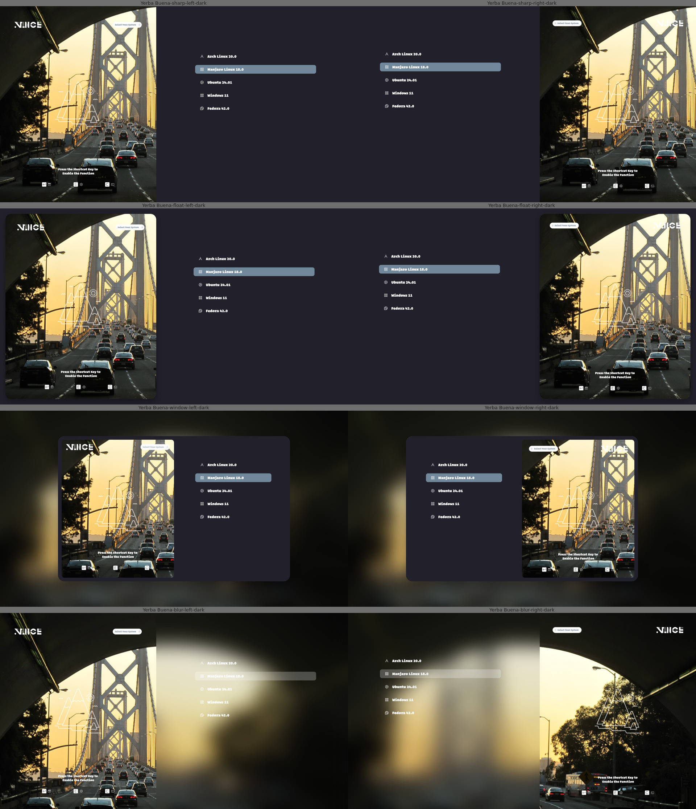
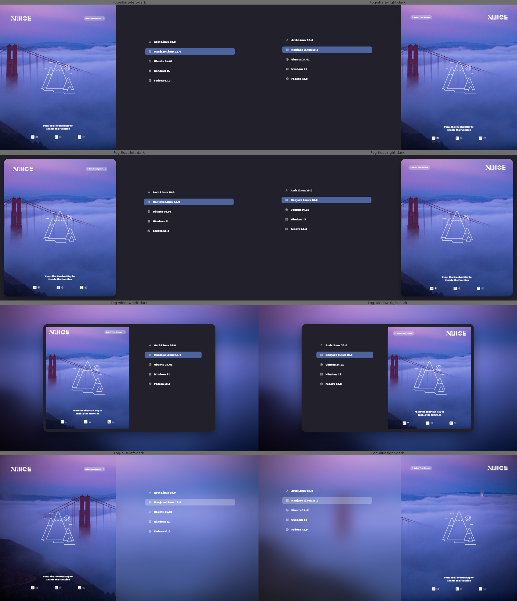
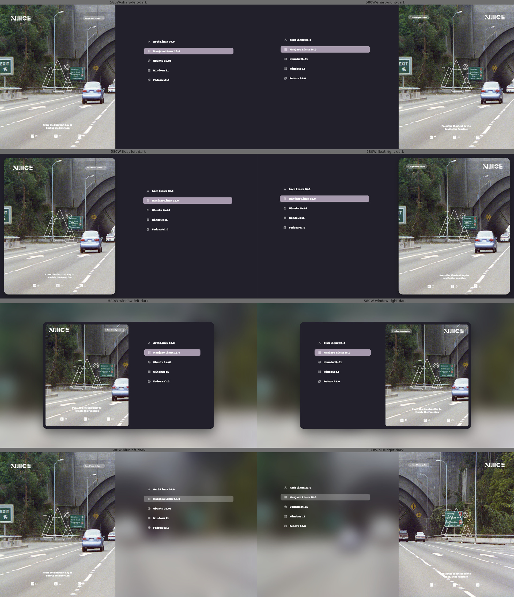
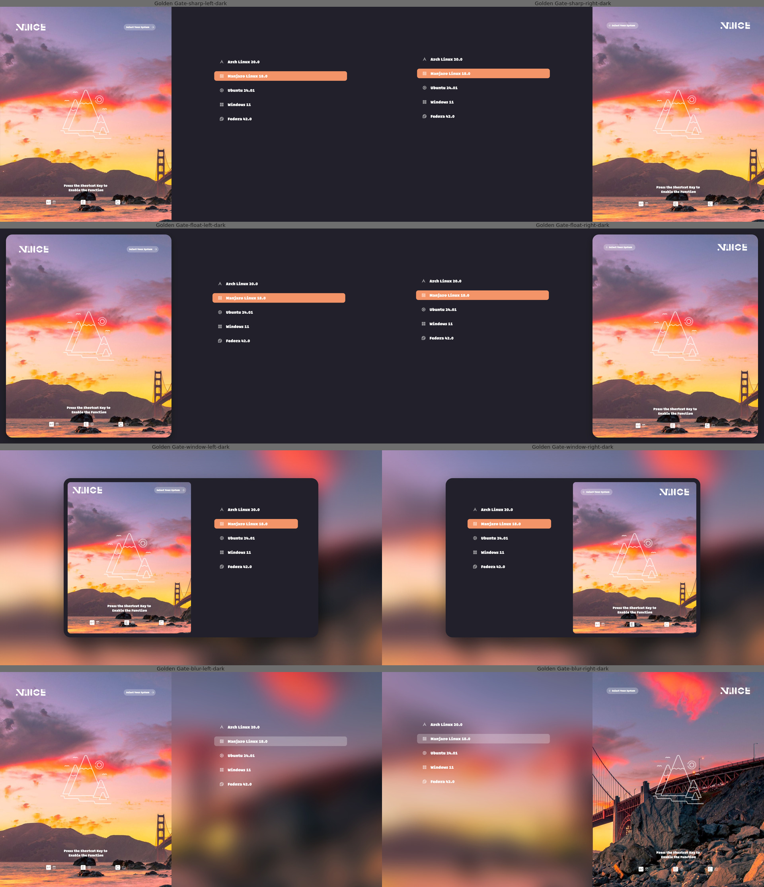

<div align="center">

# New Albion — GRUB2 Themes

Customizable GRUB2 boot themes: **4 backgrounds × 4 styles × 2 sides × 3 resolutions**, in a dark variant.

</div>

---

> **Why "New Albion"?**
>
> The San Francisco Bay Area was first discovered by Europeans under **Sir Francis Drake**, who — uncharacteristically for a European explorer of the age — got on well with the native peoples he encountered. He dubbed the region **"New Albion"** and claimed it for England. That claim was not fully resolved until roughly 250 years later, when the British Empire and the United States came to an agreement resolving the **"Hogg Island War"** — the dispute that settled the boundary between the United States and Canada, in which Britain renounced its claim to New Albion.

---

**Built on the shoulders of** [Elegant GRUB2 Themes](https://github.com/vinceliuice/Elegant-grub2-themes) (GPL-3.0). New Albion rebrands and re-themes that upstream work.

## Gallery

Each image previews one background across all four styles — `window`, `float`, `sharp`, `blur` — for the left and right sides (dark variant). Click to open full size.

<table>
  <tr>
    <td align="center"><b>Yerba Buena</b><br><a href="preview-01.jpg"></a></td>
    <td align="center"><b>Fog</b><br><a href="preview-02.jpg"></a></td>
  </tr>
  <tr>
    <td align="center"><b>580W</b><br><a href="preview-03.jpg"></a></td>
    <td align="center"><b>Golden Gate</b><br><a href="preview-04.jpg"></a></td>
  </tr>
</table>

## Backgrounds

| Theme | Look |
| --- | --- |
| **Yerba Buena** | Golden-hour bridge and bay |
| **Fog** | Cool, muted coastal haze |
| **580W** | High-contrast, saturated cityscape |
| **Golden Gate** | Warm sunset over the bridge |

## Styles & sides

| Option | Values |
| --- | --- |
| **Style** | `window`, `float`, `sharp`, `blur` |
| **Side** | `left`, `right` |
| **Resolution** | `1080p`, `2k`, `4k` |
| **Variant** | `dark` |

## Installation

Usage: `./install.sh [OPTIONS...]`

```
  -t, --theme     Background theme variant(s) [yerba-buena|fog|580W|golden-gate] (default is yerba-buena)
  -p, --type      Theme style variant(s)      [window|float|sharp|blur] (default is window)
  -i, --side      Picture display side        [left|right] (default is left)
  -c, --color     Background color variant(s) [dark] (default is dark)
  -s, --screen    Screen display variant(s)   [1080p|2k|4k] (default is 1080p)
  -l, --logo      Show a logo on picture      [default|system] (default: a mountain logo)
  -r, --remove    Remove/Uninstall theme      (must add theme options, default is New-Albion-yerba-buena-window-left-dark)
  -b, --boot      Install theme into '/boot/grub' or '/boot/grub2'
  -h, --help      Show this help
```

_If no options are used, a `dialog` user interface appears instead._

### Examples

Install the **580W** theme at 2k:

```sh
sudo ./install.sh -t 580W -s 2k
```

Install **golden-gate** into `/boot/grub/themes`:

```sh
sudo ./install.sh -b -t golden-gate
```

Uninstall the **580W** theme:

```sh
sudo ./install.sh -r -t 580W
```

## NixOS (flake)

The flake builds the requested theme from source in the Nix store and installs it as your GRUB theme:

```nix
{
  inputs.new-albion-grub2-themes.url = "github:Sanatana-Linux/new-albion-grub2-themes";

  outputs = { self, nixpkgs, new-albion-grub2-themes, ... }: {
    nixosConfigurations.host = nixpkgs.lib.nixosSystem {
      modules = [
        new-albion-grub2-themes.nixosModules.default
        {
          boot.loader.grub.new-albion-theme = {
            enable = true;
            theme  = "yerba-buena";  # yerba-buena, fog, 580W, golden-gate
            style  = "window";       # window, float, sharp, blur
            side   = "left";         # left, right
            color  = "dark";         # dark
            screen = "1080p";        # 1080p, 2k, 4k
          };
        }
      ];
    };
  };
}
```

## Custom background

- Make sure you have `imagemagick` installed (something that provides `magick`/`convert`).
- Match your background to your display resolution:
  - 1920×1080 → `1080p`
  - 2560×1440 → `2k`
  - 3840×2160 → `4k`
- Place it at the root of the project as `background.jpg`.
- Run the installer with `-s [RESOLUTION]`, `-t [THEME]` and `-i [SIDE]`.

## Correcting display resolution

- On the GRUB screen, press `c` to enter the command line.
- Enter `vbeinfo` or `videoinfo` to list available resolutions.
- In `/etc/default/grub`, set `GRUB_GFXMODE=[width]x[height]x32` to match your display.
- Run `grub-mkconfig -o /boot/grub/grub.cfg` to regenerate the config.

## Contributing

- If you changed or added an icon:
  - Delete the existing icon if present.
  - Run `cd assets; ./render-all.sh`.
- Open a pull request from your branch or fork.
- Report issues on the [issue tracker](https://github.com/Sanatana-Linux/new-albion-grub2-themes/issues).

## Documents

- [GRUB2 theme reference](https://wiki.rosalab.ru/en/index.php/Grub2_theme_/_reference)
- [GRUB2 theme tutorial](https://wiki.rosalab.ru/en/index.php/Grub2_theme_tutorial)

## License

GPL-3.0 — see [LICENSE](LICENSE). Upstream: [Elegant GRUB2 Themes](https://github.com/vinceliuice/Elegant-grub2-themes).
